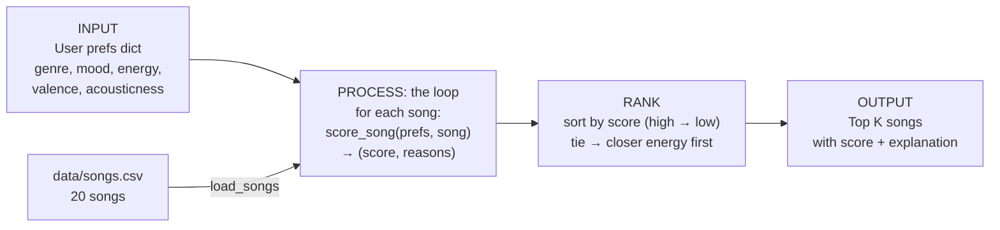

# 🎵 Music Recommender Simulation

## Project Summary

In this project you will build and explain a small music recommender system.

Your goal is to:

- Represent songs and a user "taste profile" as data
- Design a scoring rule that turns that data into recommendations
- Evaluate what your system gets right and wrong
- Reflect on how this mirrors real world AI recommenders

Replace this paragraph with your own summary of what your version does

## How The System Works

The recommender is **content-based**: it compares each song's attributes (genre, mood, energy, valence, acousticness) to the user's taste profile, gives every song a score, and returns the highest-scoring songs. It does not use listening history or other users' behavior. It only looks at what the songs sound like and what the user says they want.

### Data flow



In plain text, a single song moves through the system like this:

```
songs.csv row  →  load_songs()  →  song dict
song dict + user_prefs  →  score_song()  →  (6.29, ["genre match (+2.0)", "mood match (+1.5)", ...])
all 20 (song, score, reasons)  →  recommend_songs() sorts + slices  →  top K list
```

### Features used

- **Song:** `genre`, `mood`, `energy`, `valence`, `acousticness`
- **User profile:** a dictionary of target values for each scored feature. `genre`, `mood` and `energy` are required; `valence` and `acousticness` are optional. The default profile in `src/main.py` is a "late-night study session":

  ```python
  user_prefs = {"genre": "lofi", "mood": "chill", "energy": 0.40, "valence": 0.60, "acousticness": 0.80}
  ```

`tempo_bpm` and `danceability` are not scored. In this dataset they track energy very closely, so they would count the same signal again.

### Algorithm Recipe (final)

**Closeness formula** for any numeric feature, scored between 0 and 1:

```
closeness = max(0, 1 − 2 × abs(song_value − target_value))
```

A perfect match scores 1.0. The score drops by 0.2 for every 0.1 of distance and reaches 0 once a song is 0.5 or more away from the target. This rewards songs that are *close to* the target, not songs that are simply higher or lower.

Each song starts at 0 points and earns:

| Rule | Points | Max |
|---|---|---|
| **Genre**: exact match | +2.0 | 2.0 |
| **Genre**: partial match, where one name contains the other (e.g. "pop" / "indie pop") | +1.0 | |
| **Mood**: exact match | +1.5 | 1.5 |
| **Mood**: same mood family (see below) | +0.75 | |
| **Energy**: `1.5 × closeness` | 0–1.5 | 1.5 |
| **Valence** (if a target is given): `1.0 × closeness` | 0–1.0 | 1.0 |
| **Acousticness** (if a target is given): `0.5 × closeness` | 0–0.5 | 0.5 |

**Maximum score: 6.5** (4.5 for a profile that only gives genre, mood and energy).

**Mood families**, used for partial mood credit:

| Family | Moods |
|---|---|
| calm | chill, relaxed, peaceful, dreamy, focused |
| upbeat | happy, joyful, euphoric, energetic, confident |
| intense | intense, angry, moody |
| tender | sad, nostalgic, romantic |

**Why these weights:**
- **Genre (2.0) is slightly ahead of mood (1.5).** Genre is the user's most explicit preference. I tested a genre-heavy version (3.0 / 1.0), and it recommended Gym Hero, a pop workout song, to a user who asked for pop + chill music. That's the wrong vibe, so I kept the gap small.
- **Labels and numbers are balanced.** Genre and mood together are worth up to 3.5, and the numeric features up to 3.0. Neither side can win on its own, and no single rule is worth more than about a third of the maximum score.
- **Energy is the main numeric feature,** with valence second, because together they describe the vibe: how intense the song is and how positive it sounds.
- **Acousticness is a small tiebreaker,** because it partly overlaps with energy.

### Ranking rule

1. Score every song in the catalog with the recipe above.
2. Sort from highest to lowest score. If two songs tie, the one with the closer energy goes first.
3. Return the top `k` songs, each with its score and an explanation built from the rules it earned points from.

### Expected output (simulated)

For the study profile above:

| Rank | Song | Score | Why |
|---|---|---|---|
| 1 | Library Rain (lofi/chill) | 6.29 | genre + mood + close on all numbers |
| 2 | Midnight Coding (lofi/chill) | 6.27 | genre + mood + close on all numbers |
| 3 | Focus Flow (lofi/focused) | 5.71 | genre + mood family (calm) |
| 4 | Spacewalk Thoughts (ambient/chill) | 3.92 | mood, no genre match |
| 5 | Coffee Shop Stories (jazz/relaxed) | 3.35 | mood family (calm) |

### Potential biases and limitations I expect

- **The labels can over-rule the vibe.** Genre and mood together are worth slightly more than all the numeric features combined. A song with the right label but the wrong feel can still outrank a song that sounds right but has a different label.
- **Exact string matching is fragile.** "lofi" and "lo-fi" would be treated as different genres. Partial matching only works when one name contains the other, so "trip hop" and "hip hop" get no credit for being related.
- **The mood families are my own judgment.** Someone else might put "nostalgic" in *calm* or "moody" in *tender*, and the rankings would change.
- **The catalog is small and uneven.** Lofi has 3 songs, but most genres and moods have just one. A "sad folk" user gets one good match, then filler that scores around 2.1. Weighting can't fix a missing song.
- **There's a filter-bubble risk.** Nothing pushes the list toward variety. In the study example, 2 of the top 3 songs are by the same artist (LoRoom), and users keep getting recommendations from their stated genre.
- **The feature values are invented.** Songs 11–20 were generated with AI help, so their energy, valence and acousticness values are reasonable guesses, not measurements.
- **Context and lyrics are invisible.** The system can't tell *why* someone is listening (studying vs. relaxing) or what a song is about. A song with sad lyrics over a happy-sounding track still scores as happy.

---

## Getting Started

### Setup

1. Create a virtual environment (optional but recommended):

   ```bash
   python -m venv .venv
   source .venv/bin/activate      # Mac or Linux
   .venv\Scripts\activate         # Windows

2. Install dependencies

```bash
pip install -r requirements.txt
```

3. Run the app:

```bash
python -m src.main
```

### Running Tests

Run the starter tests with:

```bash
pytest
```

You can add more tests in `tests/test_recommender.py`.

---

## Sample Recommendation Output

Output of `python -m src.main` with the default **pop/happy** profile and the **late-night study** profile:

```
Loading songs from data/songs.csv...
Loaded songs: 20

================================================================
Profile: Pop / Happy (default)
  genre=pop, mood=happy, energy=0.8
================================================================
1. Sunrise City by Neon Echo  [pop / happy]
   Score: 4.94
     - genre match (+2.00)
     - mood match (+1.50)
     - energy 0.82 near target 0.80 (+1.44)
2. Rooftop Lights by Indigo Parade  [indie pop / happy]
   Score: 3.88
     - similar genre: indie pop (+1.00)
     - mood match (+1.50)
     - energy 0.76 near target 0.80 (+1.38)
3. Gym Hero by Max Pulse  [pop / intense]
   Score: 3.11
     - genre match (+2.00)
     - energy 0.93 near target 0.80 (+1.11)
4. Concrete Crown by Kilo Verse  [hip hop / confident]
   Score: 2.19
     - similar mood: confident (+0.75)
     - energy 0.78 near target 0.80 (+1.44)
5. Front Porch Stomp by The Creekside Pickers  [bluegrass / joyful]
   Score: 2.10
     - similar mood: joyful (+0.75)
     - energy 0.85 near target 0.80 (+1.35)

================================================================
Profile: Late-Night Study
  genre=lofi, mood=chill, energy=0.4, valence=0.6, acousticness=0.8
================================================================
1. Library Rain by Paper Lanterns  [lofi / chill]
   Score: 6.29
     - genre match (+2.00)
     - mood match (+1.50)
     - energy 0.35 near target 0.40 (+1.35)
     - valence 0.60 near target 0.60 (+1.00)
     - acousticness 0.86 near target 0.80 (+0.44)
2. Midnight Coding by LoRoom  [lofi / chill]
   Score: 6.27
     - genre match (+2.00)
     - mood match (+1.50)
     - energy 0.42 near target 0.40 (+1.44)
     - valence 0.56 near target 0.60 (+0.92)
     - acousticness 0.71 near target 0.80 (+0.41)
3. Focus Flow by LoRoom  [lofi / focused]
   Score: 5.71
     - genre match (+2.00)
     - similar mood: focused (+0.75)
     - energy 0.40 near target 0.40 (+1.50)
     - valence 0.59 near target 0.60 (+0.98)
     - acousticness 0.78 near target 0.80 (+0.48)
4. Spacewalk Thoughts by Orbit Bloom  [ambient / chill]
   Score: 3.92
     - mood match (+1.50)
     - energy 0.28 near target 0.40 (+1.14)
     - valence 0.65 near target 0.60 (+0.90)
     - acousticness 0.92 near target 0.80 (+0.38)
5. Coffee Shop Stories by Slow Stereo  [jazz / relaxed]
   Score: 3.35
     - similar mood: relaxed (+0.75)
     - energy 0.37 near target 0.40 (+1.41)
     - valence 0.71 near target 0.60 (+0.78)
     - acousticness 0.89 near target 0.80 (+0.41)
```

For pop/happy, the results match what I'd expect: Sunrise City is the only song that matches both genre and mood, so it comes first. Rooftop Lights (indie pop) earns partial genre credit, and Gym Hero matches the genre but has the wrong mood, so it ranks third. Places 4–5 go to upbeat songs from other genres that earned "similar mood" credit.

**Screenshot or video** *(optional)*: <!-- Insert a screenshot or demo video link here -->

---

## Experiments You Tried

Use this section to document the experiments you ran. For example:

- What happened when you changed the weight on genre from 2.0 to 0.5
- What happened when you added tempo or valence to the score
- How did your system behave for different types of users

---

## Limitations and Risks

Summarize some limitations of your recommender.

Examples:

- It only works on a tiny catalog
- It does not understand lyrics or language
- It might over favor one genre or mood

You will go deeper on this in your model card.

---

## Reflection

Read and complete `model_card.md`:

[**Model Card**](model_card.md)

Write 1 to 2 paragraphs here about what you learned:

- about how recommenders turn data into predictions
- about where bias or unfairness could show up in systems like this


