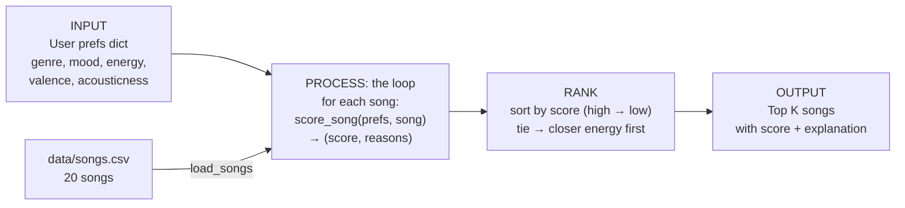

# 🎵 Music Recommender Simulation

## Project Summary

In this project you will build and explain a small music recommender system.

Your goal is to:

- Represent songs and a user "taste profile" as data
- Design a scoring rule that turns that data into recommendations
- Evaluate what your system gets right and wrong
- Reflect on how this mirrors real world AI recommenders

**VibeMatch 1.0** is a small, CLI-first, content-based music recommender. It loads a 20-song catalog from `data/songs.csv`, scores every song against a user's taste profile (genre, mood, energy, and optionally valence and acousticness), and prints the top 5 with a short reason for every point a song earned. I stress-tested it with 8 profiles, including four adversarial ones, ran a weight-shift experiment, and documented the biases I found in [`model_card.md`](model_card.md).

**VibeMatch 2.0** adds Retrieval-Augmented Generation: you can describe what you want in plain English, and Claude writes recommendations grounded in songs and notes retrieved from the project's own data (see [AI Feature](#ai-feature-retrieval-augmented-generation-vibematch-20)). With `--agent`, Claude instead plans its own steps, calls retrieval tools and checks its picks before answering (see [Agentic Workflow](#ai-feature-agentic-workflow---agent)).

## How The System Works

### How real-world recommenders work, and what mine prioritizes

Real platforms like Spotify, YouTube and Netflix mostly combine two ideas. **Collaborative filtering** learns from millions of users' behavior (plays, skips, likes, playlist adds): "people who liked what you like also liked this." **Content-based filtering** looks at the items themselves (audio features, genre tags, even lyrics) and finds things similar to what you already enjoy. At scale, these systems usually work in two stages. First, a fast step narrows millions of tracks down to a few hundred *candidates*. Then a model *ranks* those candidates, often re-ranking for freshness, variety, and business goals. They also learn constantly from feedback, so every skip changes what you see next.

My version is a tiny, transparent piece of that picture. It is **purely content-based**: no listening history, no other users, no learning. It prioritizes **matching the vibe the user asks for**. Genre and mood labels are worth the most points, but energy and valence (how intense and how happy a song sounds) carry nearly as much weight. Every point is explained, so you can see exactly why a song was picked. That's something real systems rarely show.

### Data flow



In plain text, a single song moves through the system like this:

```
songs.csv row  →  load_songs()  →  song dict
song dict + user_prefs  →  score_song()  →  (6.29, ["genre match (+2.0)", "mood match (+1.5)", ...])
all 20 (song, score, reasons)  →  recommend_songs() sorts + slices  →  top K list
```

### Features used

**`Song`** (one row of `songs.csv`):

| Field | Type | Used in scoring? |
|---|---|---|
| `id`, `title`, `artist` | int / str | No, only for display |
| `genre` | str | Yes: exact or partial match |
| `mood` | str | Yes: exact match or same mood family |
| `energy` | float 0–1 | Yes: closeness to target |
| `valence` | float 0–1 | Yes: closeness to target |
| `acousticness` | float 0–1 | Yes: closeness to target |
| `tempo_bpm`, `danceability` | float | No, because they overlap with energy |

**`UserProfile`** (taste profile):

| Field | Type | Meaning |
|---|---|---|
| `favorite_genre` | str | Preferred style, e.g. `"lofi"` |
| `favorite_mood` | str | Preferred vibe, e.g. `"chill"` |
| `target_energy` | float 0–1 | How intense the music should be |
| `likes_acoustic` | bool | Turned into an acousticness target (0.8 if True, 0.2 if False) |

The functional version (`score_song` / `recommend_songs`) takes the same information as a dictionary, which can also include an optional `valence` and an exact `acousticness` target. For example, the "late-night study" profile in `src/main.py`:

```python
user_prefs = {"genre": "lofi", "mood": "chill", "energy": 0.40, "valence": 0.60, "acousticness": 0.80}
```

`python -m src.main --profiles` runs these 8 profiles. The default is `{"genre": "pop", "mood": "happy", "energy": 0.8}`.

`tempo_bpm` and `danceability` are not scored. In this dataset they track energy very closely, so they would count the same signal again.

### Algorithm Recipe (final)

**Closeness formula** for any numeric feature, scored between 0 and 1:

```
closeness = max(0, 1 − 2 × abs(song_value − target_value))
```

A perfect match scores 1.0. The score drops by 0.2 for every 0.1 of distance and reaches 0 once a song is 0.5 or more away from the target. This rewards songs that are *close to* the target, not songs that are simply higher or lower.

Each song starts at 0 points and earns:

| Rule | Points | Max |
|---|---|---|
| **Genre**: exact match | +2.0 | 2.0 |
| **Genre**: partial match, where one name contains the other (e.g. "pop" / "indie pop") | +1.0 | |
| **Mood**: exact match | +1.5 | 1.5 |
| **Mood**: same mood family (see below) | +0.75 | |
| **Energy**: `1.5 × closeness` | 0–1.5 | 1.5 |
| **Valence** (if a target is given): `1.0 × closeness` | 0–1.0 | 1.0 |
| **Acousticness** (if a target is given): `0.5 × closeness` | 0–0.5 | 0.5 |

**Maximum score: 6.5** (4.5 for a profile that only gives genre, mood and energy).

**Mood families**, used for partial mood credit:

| Family | Moods |
|---|---|
| calm | chill, relaxed, peaceful, dreamy, focused |
| upbeat | happy, joyful, euphoric, energetic, confident |
| intense | intense, angry, moody |
| tender | sad, nostalgic, romantic |

**Why these weights:**
- **Genre (2.0) is slightly ahead of mood (1.5).** Genre is the user's most explicit preference. I tested a genre-heavy version (3.0 / 1.0), and it recommended Gym Hero, a pop workout song, to a user who asked for pop + chill music. That's the wrong vibe, so I kept the gap small.
- **Labels and numbers are balanced.** Genre and mood together are worth up to 3.5, and the numeric features up to 3.0. Neither side can win on its own, and no single rule is worth more than about a third of the maximum score.
- **Energy is the main numeric feature,** with valence second, because together they describe the vibe: how intense the song is and how positive it sounds.
- **Acousticness is a small tiebreaker,** because it partly overlaps with energy.

### Ranking rule

1. Score every song in the catalog with the recipe above.
2. Sort from highest to lowest score. If two songs tie, the one with the closer energy goes first.
3. Return the top `k` songs, each with its score and an explanation built from the rules it earned points from.

### Expected output (simulated)

For the study profile above:

| Rank | Song | Score | Why |
|---|---|---|---|
| 1 | Library Rain (lofi/chill) | 6.29 | genre + mood + close on all numbers |
| 2 | Midnight Coding (lofi/chill) | 6.27 | genre + mood + close on all numbers |
| 3 | Focus Flow (lofi/focused) | 5.71 | genre + mood family (calm) |
| 4 | Spacewalk Thoughts (ambient/chill) | 3.92 | mood, no genre match |
| 5 | Coffee Shop Stories (jazz/relaxed) | 3.35 | mood family (calm) |

### Potential biases and limitations I expect

- **The labels can over-rule the vibe.** Genre and mood together are worth slightly more than all the numeric features combined. A song with the right label but the wrong feel can still outrank a song that sounds right but has a different label.
- **Exact string matching is fragile.** "lofi" and "lo-fi" would be treated as different genres. Partial matching only works when one name contains the other, so "trip hop" and "hip hop" get no credit for being related.
- **The mood families are my own judgment.** Someone else might put "nostalgic" in *calm* or "moody" in *tender*, and the rankings would change.
- **The catalog is small and uneven.** Lofi has 3 songs, but most genres and moods have just one. A "sad folk" user gets one good match, then filler that scores around 2.1. Weighting can't fix a missing song.
- **There's a filter-bubble risk.** Nothing pushes the list toward variety. In the study example, 2 of the top 3 songs are by the same artist (LoRoom), and users keep getting recommendations from their stated genre.
- **The feature values are invented.** Songs 11–20 were generated with AI help, so their energy, valence and acousticness values are reasonable guesses, not measurements.
- **Context and lyrics are invisible.** The system can't tell *why* someone is listening (studying vs. relaxing) or what a song is about. A song with sad lyrics over a happy-sounding track still scores as happy.

---

## AI Feature: Retrieval-Augmented Generation (VibeMatch 2.0)

VibeMatch 2.0 lets you ask for music in plain English, for example `"something sad for a rainy day"`. The request goes through a RAG pipeline (`src/rag.py`), and Claude writes the final answer **from the retrieved data only**:

1. **Retrieve notes.** Keyword search over `data/knowledge_base.json` (13 notes about activities, moods and genres). Each note carries text for Claude *and* suggested targets (e.g. studying → energy 0.40, acousticness 0.80).
2. **Retrieve songs.** The request + retrieved notes become a `user_prefs` dict, and the original scorer ranks the catalog. The top 5 are the only songs Claude may recommend.
3. **Generate.** Claude (`claude-opus-5-5`) receives the request, the notes and the 5 candidates with their scores and match reasons, and writes 3 picks grounded in that data.
4. **Check (guardrail).** Code verifies every pick is a retrieved candidate and no other catalog song is named. On failure the problems are sent back to Claude for one retry; if it still fails, or the API errors, the app falls back to a template answer built from the same retrieved data.

So retrieval changes the answer itself: the notes decide which songs are retrieved, and Claude can only recommend those songs. See [`diagrams/architecture.md`](diagrams/architecture.md).

## AI Feature: Agentic Workflow (`--agent`)

With `--agent`, Claude runs the retrieval itself instead of following the fixed pipeline (`src/agent.py`). It works in three phases:

1. **Plan.** Every tool call includes a `reason`: Claude's plan for that step, which is logged.
2. **Act.** Claude chooses which tools to call and with what arguments:
   - `search_notes(query)` searches the knowledge base.
   - `find_songs(genre, mood, energy, valence, acousticness, k)` ranks the catalog with targets Claude picks. Claude can call it again with adjusted targets if the first results are weak.
3. **Check.** Claude calls `check_picks(titles)` to confirm its picks were really returned by `find_songs`, and fixes problems before answering. The code then runs `check_answer()` on the final answer independently; a failed answer is sent back once for correction.

Agent guardrails: at most 8 model calls per request, every tool input is validated (bad values are returned to Claude as tool errors), unknown tools are rejected, and if the agent hits the limit, errors, is refused or never produces a checked answer, the app falls back to the template answer. Without an API key, `--agent` runs the offline RAG pipeline and says so.

Example log for `python -m src.main --agent "lofi for studying"`:

```
Step 1: search_notes(query='studying') | plan: Learn what suits studying.
Step 2: find_songs(genre='lofi', mood='chill', energy=0.4) | plan: Use study targets.
Step 3: check_picks(titles=[...]) | plan: Verify before answering.
Step 3: check_picks -> {"ok": true, "problems": []}
Step 4: final answer passed check_answer()
```

(Illustrative; the exact steps depend on what Claude decides.)

**Guardrails and logging**

- Empty requests are rejected; requests longer than 300 characters are cut.
- The request is treated as data in the prompt, and the output check rejects songs outside the retrieved set.
- API errors, refusals and a missing API key all fall back safely instead of crashing; a request that matches nothing says so.
- Malformed data files are reported with a clear message.
- Every step (notes retrieved, prefs built, candidates, each attempt and check result) is written to `logs/vibematch.log`. Add `-v` to also print it on screen.

---

## Getting Started

### Requirements

- Python 3.11 or newer (tested on 3.13)
- Optional: an Anthropic API key for Claude-written answers. Without one the app still runs and uses template answers.

### Setup

```bash
git clone https://github.com/AkhilRB0204/applied-ai-system-project.git
cd applied-ai-system-project

python3 -m venv .venv
source .venv/bin/activate          # Windows: .venv\Scripts\activate

python -m pip install --upgrade pip
pip install -r requirements.txt

export ANTHROPIC_API_KEY=sk-ant-...   # optional; Windows: set ANTHROPIC_API_KEY=sk-ant-...
```

Run every command from the project folder (the app reads `data/` with relative paths).

### Run the app

```bash
python -m src.main "chill lo-fi music for studying late at night"   # one request
python -m src.main                                                   # interactive, blank line quits
python -m src.main --agent "something sad for a rainy day"           # agentic workflow (needs API key)
python -m src.main --offline "music for the gym"                     # skip Claude
python -m src.main -v "something romantic for dinner"                # show log lines too
python -m src.main --profiles                                        # original 8-profile demo (VibeMatch 1.0)
```

### Running Tests

```bash
pytest
```

The 23 tests run offline: Claude is replaced by a scripted fake client, so no API key or network is needed. `tests/test_rag.py` covers retrieval, the output check, the retry, the fallbacks and the input guardrails. `tests/test_agent.py` covers the agent's plan/act/check loop, the correction round, the step limit, invalid tool inputs and the fallbacks.

---

## Sample Recommendation Output

Output of `python -m src.main --profiles`. It runs 8 profiles: three "normal" listeners (pop, lofi, rock), the default pop/happy profile, and four **adversarial** profiles designed to trick the scoring logic:

| Profile | What it tests |
|---|---|
| Sad Banger | Conflicting preferences: a *sad* mood with a 0.9 energy target |
| Unknown K-Pop / hype | Genre and mood that aren't in the catalog at all |
| 'lo-fi' spelling | A spelling variant of a genre that does exist (`lofi`) |
| Angry Classical | Contradictory labels: a calm genre with an angry mood |

```
Loading songs from data/songs.csv...
Loaded songs: 20

================================================================
Profile: Pop / Happy (default)
  genre=pop, mood=happy, energy=0.8
================================================================
1. Sunrise City by Neon Echo  [pop / happy]
   Score: 4.94
     - genre match (+2.00)
     - mood match (+1.50)
     - energy 0.82 near target 0.80 (+1.44)
2. Rooftop Lights by Indigo Parade  [indie pop / happy]
   Score: 3.88
     - similar genre: indie pop (+1.00)
     - mood match (+1.50)
     - energy 0.76 near target 0.80 (+1.38)
3. Gym Hero by Max Pulse  [pop / intense]
   Score: 3.11
     - genre match (+2.00)
     - energy 0.93 near target 0.80 (+1.11)
4. Concrete Crown by Kilo Verse  [hip hop / confident]
   Score: 2.19
     - similar mood: confident (+0.75)
     - energy 0.78 near target 0.80 (+1.44)
5. Front Porch Stomp by The Creekside Pickers  [bluegrass / joyful]
   Score: 2.10
     - similar mood: joyful (+0.75)
     - energy 0.85 near target 0.80 (+1.35)

================================================================
Profile: High-Energy Pop
  genre=pop, mood=happy, energy=0.85, valence=0.85, acousticness=0.15
================================================================
1. Sunrise City by Neon Echo  [pop / happy]
   Score: 6.36
     - genre match (+2.00)
     - mood match (+1.50)
     - energy 0.82 near target 0.85 (+1.41)
     - valence 0.84 near target 0.85 (+0.98)
     - acousticness 0.18 near target 0.15 (+0.47)
2. Rooftop Lights by Indigo Parade  [indie pop / happy]
   Score: 4.95
     - similar genre: indie pop (+1.00)
     - mood match (+1.50)
     - energy 0.76 near target 0.85 (+1.23)
     - valence 0.81 near target 0.85 (+0.92)
     - acousticness 0.35 near target 0.15 (+0.30)
3. Gym Hero by Max Pulse  [pop / intense]
   Score: 4.50
     - genre match (+2.00)
     - energy 0.93 near target 0.85 (+1.26)
     - valence 0.77 near target 0.85 (+0.84)
     - acousticness 0.05 near target 0.15 (+0.40)
4. Fiesta de Medianoche by Los Rayos  [latin / energetic]
   Score: 3.47
     - similar mood: energetic (+0.75)
     - energy 0.86 near target 0.85 (+1.47)
     - valence 0.90 near target 0.85 (+0.90)
     - acousticness 0.30 near target 0.15 (+0.35)
5. Bassline Euphoria by Pulse Theory  [edm / euphoric]
   Score: 3.26
     - similar mood: euphoric (+0.75)
     - energy 0.95 near target 0.85 (+1.20)
     - valence 0.88 near target 0.85 (+0.94)
     - acousticness 0.02 near target 0.15 (+0.37)

================================================================
Profile: Chill Lofi (late-night study)
  genre=lofi, mood=chill, energy=0.4, valence=0.6, acousticness=0.8
================================================================
1. Library Rain by Paper Lanterns  [lofi / chill]
   Score: 6.29
     - genre match (+2.00)
     - mood match (+1.50)
     - energy 0.35 near target 0.40 (+1.35)
     - valence 0.60 near target 0.60 (+1.00)
     - acousticness 0.86 near target 0.80 (+0.44)
2. Midnight Coding by LoRoom  [lofi / chill]
   Score: 6.27
     - genre match (+2.00)
     - mood match (+1.50)
     - energy 0.42 near target 0.40 (+1.44)
     - valence 0.56 near target 0.60 (+0.92)
     - acousticness 0.71 near target 0.80 (+0.41)
3. Focus Flow by LoRoom  [lofi / focused]
   Score: 5.71
     - genre match (+2.00)
     - similar mood: focused (+0.75)
     - energy 0.40 near target 0.40 (+1.50)
     - valence 0.59 near target 0.60 (+0.98)
     - acousticness 0.78 near target 0.80 (+0.48)
4. Spacewalk Thoughts by Orbit Bloom  [ambient / chill]
   Score: 3.92
     - mood match (+1.50)
     - energy 0.28 near target 0.40 (+1.14)
     - valence 0.65 near target 0.60 (+0.90)
     - acousticness 0.92 near target 0.80 (+0.38)
5. Coffee Shop Stories by Slow Stereo  [jazz / relaxed]
   Score: 3.35
     - similar mood: relaxed (+0.75)
     - energy 0.37 near target 0.40 (+1.41)
     - valence 0.71 near target 0.60 (+0.78)
     - acousticness 0.89 near target 0.80 (+0.41)

================================================================
Profile: Deep Intense Rock
  genre=rock, mood=intense, energy=0.92, valence=0.4, acousticness=0.1
================================================================
1. Storm Runner by Voltline  [rock / intense]
   Score: 6.31
     - genre match (+2.00)
     - mood match (+1.50)
     - energy 0.91 near target 0.92 (+1.47)
     - valence 0.48 near target 0.40 (+0.84)
     - acousticness 0.10 near target 0.10 (+0.50)
2. Gym Hero by Max Pulse  [pop / intense]
   Score: 3.68
     - mood match (+1.50)
     - energy 0.93 near target 0.92 (+1.47)
     - valence 0.77 near target 0.40 (+0.26)
     - acousticness 0.05 near target 0.10 (+0.45)
3. Iron Tempest by Graveforge  [metal / angry]
   Score: 3.23
     - similar mood: angry (+0.75)
     - energy 0.97 near target 0.92 (+1.35)
     - valence 0.25 near target 0.40 (+0.70)
     - acousticness 0.03 near target 0.10 (+0.43)
4. Night Drive Loop by Neon Echo  [synthwave / moody]
   Score: 2.94
     - similar mood: moody (+0.75)
     - energy 0.75 near target 0.92 (+0.99)
     - valence 0.49 near target 0.40 (+0.82)
     - acousticness 0.22 near target 0.10 (+0.38)
5. Concrete Crown by Kilo Verse  [hip hop / confident]
   Score: 2.12
     - energy 0.78 near target 0.92 (+1.08)
     - valence 0.62 near target 0.40 (+0.56)
     - acousticness 0.08 near target 0.10 (+0.48)

================================================================
Profile: Adversarial: Sad Banger (sad mood, 0.9 energy)
  genre=pop, mood=sad, energy=0.9, valence=0.2
================================================================
1. Gym Hero by Max Pulse  [pop / intense]
   Score: 3.41
     - genre match (+2.00)
     - energy 0.93 near target 0.90 (+1.41)
2. Sunrise City by Neon Echo  [pop / happy]
   Score: 3.26
     - genre match (+2.00)
     - energy 0.82 near target 0.90 (+1.26)
3. Ashes in Winter by Hollow Pines  [folk / sad]
   Score: 2.46
     - mood match (+1.50)
     - valence 0.22 near target 0.20 (+0.96)
4. Iron Tempest by Graveforge  [metal / angry]
   Score: 2.19
     - energy 0.97 near target 0.90 (+1.29)
     - valence 0.25 near target 0.20 (+0.90)
5. Rooftop Lights by Indigo Parade  [indie pop / happy]
   Score: 2.08
     - similar genre: indie pop (+1.00)
     - energy 0.76 near target 0.90 (+1.08)

================================================================
Profile: Adversarial: Unknown K-Pop / hype
  genre=k-pop, mood=hype, energy=0.8
================================================================
1. Sunrise City by Neon Echo  [pop / happy]
   Score: 2.44
     - similar genre: pop (+1.00)
     - energy 0.82 near target 0.80 (+1.44)
2. Gym Hero by Max Pulse  [pop / intense]
   Score: 2.11
     - similar genre: pop (+1.00)
     - energy 0.93 near target 0.80 (+1.11)
3. Concrete Crown by Kilo Verse  [hip hop / confident]
   Score: 1.44
     - energy 0.78 near target 0.80 (+1.44)
4. Rooftop Lights by Indigo Parade  [indie pop / happy]
   Score: 1.38
     - energy 0.76 near target 0.80 (+1.38)
5. Front Porch Stomp by The Creekside Pickers  [bluegrass / joyful]
   Score: 1.35
     - energy 0.85 near target 0.80 (+1.35)

================================================================
Profile: Adversarial: 'lo-fi' spelling
  genre=lo-fi, mood=chill, energy=0.4
================================================================
1. Midnight Coding by LoRoom  [lofi / chill]
   Score: 2.94
     - mood match (+1.50)
     - energy 0.42 near target 0.40 (+1.44)
2. Library Rain by Paper Lanterns  [lofi / chill]
   Score: 2.85
     - mood match (+1.50)
     - energy 0.35 near target 0.40 (+1.35)
3. Spacewalk Thoughts by Orbit Bloom  [ambient / chill]
   Score: 2.64
     - mood match (+1.50)
     - energy 0.28 near target 0.40 (+1.14)
4. Focus Flow by LoRoom  [lofi / focused]
   Score: 2.25
     - similar mood: focused (+0.75)
     - energy 0.40 near target 0.40 (+1.50)
5. Glass Cathedral by Mira Static  [trip hop / dreamy]
   Score: 2.19
     - similar mood: dreamy (+0.75)
     - energy 0.38 near target 0.40 (+1.44)

================================================================
Profile: Adversarial: Angry Classical
  genre=classical, mood=angry, energy=0.5, valence=0.5, acousticness=0.5
================================================================
1. Moonlit Sonata No. 2 by Elise Hartmann  [classical / peaceful]
   Score: 3.47
     - genre match (+2.00)
     - energy 0.18 near target 0.50 (+0.54)
     - valence 0.45 near target 0.50 (+0.90)
     - acousticness 0.97 near target 0.50 (+0.03)
2. Night Drive Loop by Neon Echo  [synthwave / moody]
   Score: 2.70
     - similar mood: moody (+0.75)
     - energy 0.75 near target 0.50 (+0.75)
     - valence 0.49 near target 0.50 (+0.98)
     - acousticness 0.22 near target 0.50 (+0.22)
3. Velvet Hours by Amara Lane  [r&b / romantic]
   Score: 2.48
     - energy 0.52 near target 0.50 (+1.44)
     - valence 0.68 near target 0.50 (+0.64)
     - acousticness 0.40 near target 0.50 (+0.40)
4. Midnight Coding by LoRoom  [lofi / chill]
   Score: 2.43
     - energy 0.42 near target 0.50 (+1.26)
     - valence 0.56 near target 0.50 (+0.88)
     - acousticness 0.71 near target 0.50 (+0.29)
5. Dusty Backroads by Clay Whitaker  [country / nostalgic]
   Score: 2.24
     - energy 0.58 near target 0.50 (+1.26)
     - valence 0.66 near target 0.50 (+0.68)
     - acousticness 0.70 near target 0.50 (+0.30)
```

For pop/happy, the results match what I'd expect. Sunrise City is the only song that matches both genre and mood, so it comes first. Rooftop Lights (indie pop) earns partial genre credit, and Gym Hero matches the genre but has the wrong mood, so it ranks third. See `model_card.md` (Evaluation) for what each profile shows.

**Screenshot or video** *(optional)*: <!-- Insert a screenshot or demo video link here -->

---

## Experiments You Tried

### Weight shift: genre halved (2.0 → 1.0), energy doubled (1.5 → 3.0)

I changed the two constants at the top of `src/recommender.py`, checked that the math still holds (maximum score goes from 6.5 to 7.0, and every song's score stays between 0 and the maximum), ran all 8 profiles, then restored the original weights. Top 5 under the experiment:

```
Profile: Pop / Happy (default)
  1. Sunrise City             [pop / happy]                 5.38
  2. Rooftop Lights           [indie pop / happy]           4.76
  3. Concrete Crown           [hip hop / confident]         3.63
  4. Front Porch Stomp        [bluegrass / joyful]          3.45
  5. Fiesta de Medianoche     [latin / energetic]           3.39

Profile: High-Energy Pop
  1. Sunrise City             [pop / happy]                 6.77
  2. Rooftop Lights           [indie pop / happy]           5.68
  3. Fiesta de Medianoche     [latin / energetic]           4.94
  4. Gym Hero                 [pop / intense]               4.76
  5. Front Porch Stomp        [bluegrass / joyful]          4.73

Profile: Chill Lofi (late-night study)
  1. Midnight Coding          [lofi / chill]                6.71
  2. Library Rain             [lofi / chill]                6.64
  3. Focus Flow               [lofi / focused]              6.21
  4. Spacewalk Thoughts       [ambient / chill]             5.06
  5. Coffee Shop Stories      [jazz / relaxed]              4.76

Profile: Deep Intense Rock
  1. Storm Runner             [rock / intense]              6.78
  2. Gym Hero                 [pop / intense]               5.15
  3. Iron Tempest             [metal / angry]               4.58
  4. Night Drive Loop         [synthwave / moody]           3.93
  5. Bassline Euphoria        [edm / euphoric]              3.28

Profile: Adversarial: Sad Banger (sad mood, 0.9 energy)
  1. Gym Hero                 [pop / intense]               3.82
  2. Sunrise City             [pop / happy]                 3.52
  3. Iron Tempest             [metal / angry]               3.48
  4. Storm Runner             [rock / intense]              3.38
  5. Fiesta de Medianoche     [latin / energetic]           2.76

Profile: Adversarial: Unknown K-Pop / hype
  1. Sunrise City             [pop / happy]                 3.38
  2. Concrete Crown           [hip hop / confident]         2.88
  3. Rooftop Lights           [indie pop / happy]           2.76
  4. Gym Hero                 [pop / intense]               2.72
  5. Front Porch Stomp        [bluegrass / joyful]          2.70

Profile: Adversarial: 'lo-fi' spelling
  1. Midnight Coding          [lofi / chill]                4.38
  2. Library Rain             [lofi / chill]                4.20
  3. Spacewalk Thoughts       [ambient / chill]             3.78
  4. Focus Flow               [lofi / focused]              3.75
  5. Glass Cathedral          [trip hop / dreamy]           3.63

Profile: Adversarial: Angry Classical
  1. Velvet Hours             [r&b / romantic]              3.92
  2. Midnight Coding          [lofi / chill]                3.69
  3. Dusty Backroads          [country / nostalgic]         3.50
  4. Night Drive Loop         [synthwave / moody]           3.45
  5. Focus Flow               [lofi / focused]              3.44
```

**What changed compared with the normal weights:**

| Profile | Change | Better or just different? |
|---|---|---|
| Pop / Happy | Gym Hero (pop/*intense*) drops out of the top 5; upbeat songs from other genres (Concrete Crown, Front Porch Stomp, Fiesta de Medianoche) take its place | **Better.** These match the happy vibe more than a workout song does |
| Sad Banger | Ashes in Winter, the only *sad* song, drops out of the top 5 entirely; the list becomes all high-energy songs | **Worse.** The user's mood is now ignored |
| Angry Classical | Moonlit Sonata, the only classical song, drops out; Velvet Hours (r&b/romantic) wins just because its energy is 0.52 | **Worse.** The winner matches neither label |
| Chill Lofi | Midnight Coding passes Library Rain (its energy is closer to 0.40) | Just different. Both are good picks |
| Deep Intense Rock | Same top 4 | No real change |

**Conclusion:** doubling energy mostly made the results *different*, not more accurate. It fixed the Gym Hero problem for happy-pop users, but energy became a filter that overrides everything else, which breaks any user whose mood or genre doesn't line up with their energy. I kept the original weights.

---

## Limitations and Risks

- **Tiny, uneven catalog.** It has 20 songs, and 14 of the 17 genres have exactly one song. After the first match, the list is often filler.
- **The same songs keep appearing.** Gym Hero shows up in 5 of the 8 profiles' top 5s because it's labeled pop, labeled intense, and is very high-energy.
- **Fragile labels.** `lo-fi` doesn't match `lofi`, which costs all 2 genre points (with the same targets, the top score drops from 4.94 to 2.94). `k-pop` *does* match `pop`, but only by accident of spelling.
- **Low-energy listeners are underserved.** Only 4 songs earn any energy points for a target of 0.1, compared with 10 for a target of 0.9.
- **No lyrics, context, or listening history.** It only sees five numbers and two labels per song.

More detail is in [`model_card.md`](model_card.md).

---

## Reflection

Read and complete `model_card.md`:

[**Model Card**](model_card.md)

**How recommenders turn data into predictions.** Building this showed me that a "recommendation" is really two separate decisions. First, a scoring rule judges each song alone. Then a ranking rule turns those scores into a list. Neither step understands music. The system turns a vague idea like "I want something chill for studying" into a few numbers and labels, measures the distance between those and every song, and sorts. What surprised me is how *right* that can feel. The lofi study list is honestly the playlist I'd make myself, and the explanations ("mood match +1.5") make it sound thoughtful even though it's just addition.

**Where bias and unfairness show up.** Bias showed up without any bugs. Every rule was reasonable on its own, but a 2-point genre label beat a 1.5-point mood match. So a user who wanted *sad* pop got an upbeat workout song, and an "angry classical" user got a peaceful piano piece. The data added its own bias: most genres have one song, the catalog leans high-energy, and spelling decides whether you get credit ("lo-fi" loses, "k-pop" wins by accident). The users who get the worst results are the ones whose taste doesn't fit the common patterns, and the results still *look* plausible, so nobody would notice without testing edge cases on purpose. In a real app, with millions of users and no explanations, those quiet failures would be much harder to see.


