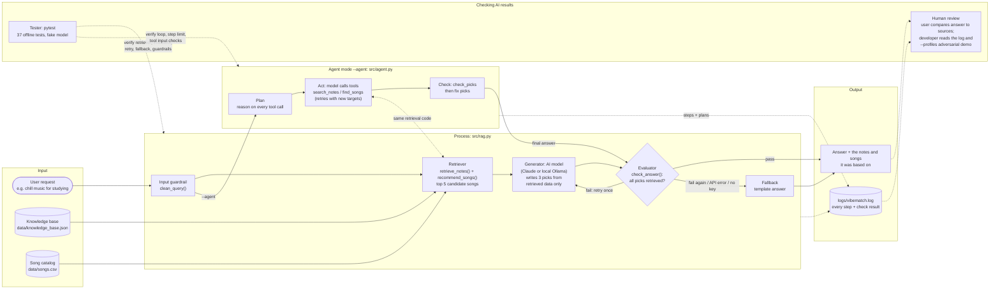

# System Diagram

How VibeMatch 2.0 is organized: a request flows from **input** through **retrieval, generation and evaluation** to an **output**, with tests and humans checking the AI's results. The Mermaid source is also kept as [`architecture.mmd`](architecture.mmd).

## Components

| Component | Where | Role |
|---|---|---|
| Input guardrail | `clean_query()` in `src/rag.py` | Rejects empty requests, cuts ones over 300 characters |
| Retriever | `retrieve_notes()`, `build_prefs()`, `recommend_songs()` | Finds matching knowledge-base notes, turns them into targets, retrieves the top 5 songs |
| Generator | Claude `claude-opus-5-5`, or the free local `qwen3:4b-instruct` via Ollama, through `ask()` | Writes 3 picks using only the retrieved notes and songs |
| Agent | `ask_agent()` in `src/agent.py`, with `--agent` | The model plans each step, calls `search_notes` / `find_songs` / `check_picks`, and fixes its picks before answering |
| Evaluator | `check_answer()` | Rejects picks that were not retrieved; triggers one retry, then the fallback |
| Fallback | `fallback_answer()` | Template answer from retrieved data when the model fails, errors or no model is available |
| Logger | `logs/vibematch.log` | Records every step and check result |
| CLI | `src/main.py` | Runs requests, interactive mode, and the `--profiles` demo |

## Where results are checked

- **Automatically, every request:** the evaluator checks the model's answer before it is shown. In agent mode the model also checks its own picks with `check_picks` first.
- **Tests:** `pytest` runs 37 offline tests (scripted fake model client) covering the retriever, evaluator, retry, fallbacks, guardrails, and the agent's loop, step limit and tool-input validation.
- **Humans:** the user sees the answer next to the notes and songs it came from, so unsupported claims are easy to spot; the developer reviews `logs/vibematch.log` and the adversarial profiles in `python -m src.main --profiles` (findings in `model_card.md`).
