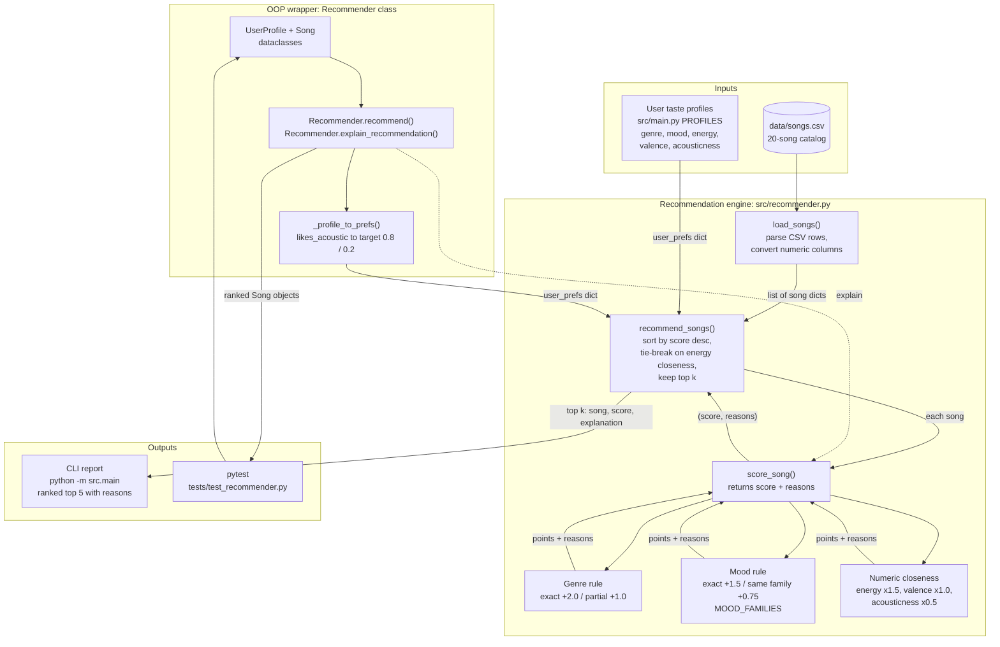

# System Architecture

How VibeMatch turns a song catalog and a user taste profile into ranked, explained recommendations. The Mermaid source is also kept as [`architecture.mmd`](architecture.mmd).

## Components

- **Inputs:** `data/songs.csv` (20-song catalog) and the taste profiles in `src/main.py`.
- **Recommendation engine (`src/recommender.py`):** `load_songs()` parses the catalog; `recommend_songs()` sends each song to `score_song()`, which adds genre, mood-family and numeric-closeness points and records a reason for each; results are sorted by score (ties broken by energy closeness) and the top k are kept.
- **OOP wrapper:** the `Recommender` class with `Song` and `UserProfile` dataclasses; `_profile_to_prefs()` converts a profile into the same `user_prefs` dict the engine uses.
- **Outputs:** the CLI report (`python -m src.main`) and the pytest suite (`tests/test_recommender.py`).
