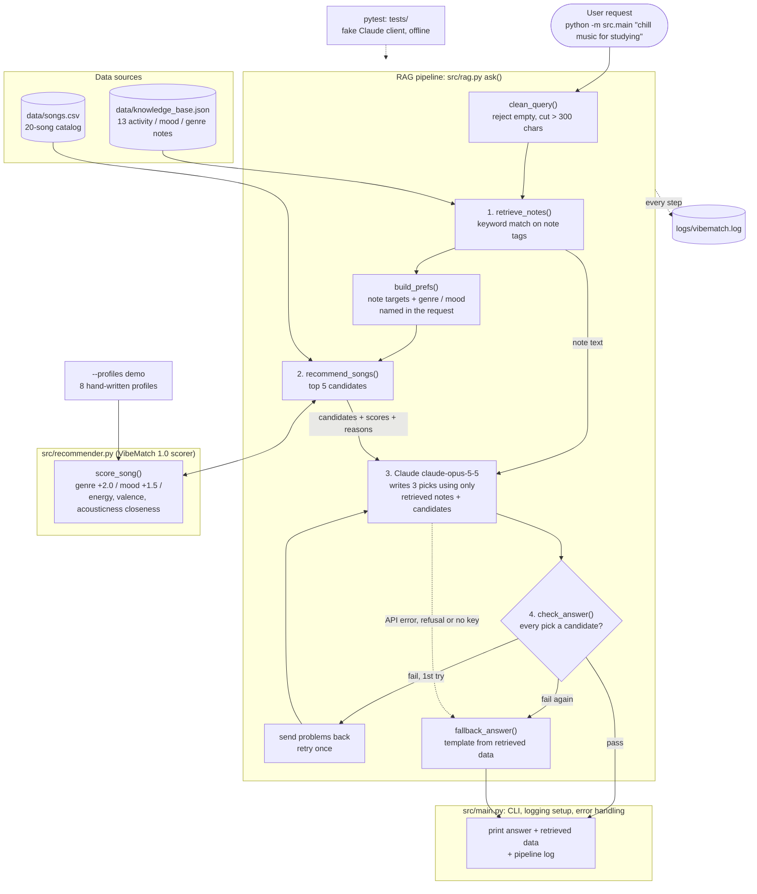

# System Architecture

How VibeMatch 2.0 turns a plain-English request into recommendations grounded in retrieved data. The Mermaid source is also kept as [`architecture.mmd`](architecture.mmd).

## Components

- **Data sources:** `data/songs.csv` (20-song catalog) and `data/knowledge_base.json` (notes about activities, moods and genres, each with text and suggested targets).
- **CLI (`src/main.py`):** parses arguments, sets up logging to `logs/vibematch.log`, loads data with clear errors, and prints the answer next to the data it came from. `--profiles` runs the original 8-profile demo.
- **RAG pipeline (`src/rag.py`):**
  1. `retrieve_notes()` finds notes whose tags match the request.
  2. `build_prefs()` turns the notes and any genre/mood named in the request into `user_prefs`; `recommend_songs()` retrieves the top 5 candidates.
  3. Claude writes 3 picks using only the retrieved notes and candidates.
  4. `check_answer()` rejects picks outside the candidates; Claude gets one retry with the problems listed, then `fallback_answer()` takes over. API errors, refusals and a missing key also use the fallback.
- **Scorer (`src/recommender.py`):** the VibeMatch 1.0 scoring rules, reused as the song retriever.
- **Tests:** `tests/` run offline with a fake Claude client.
